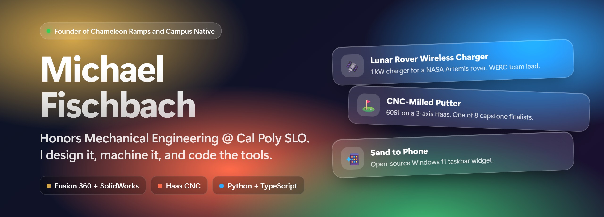

  
  
  

### Hey, I'm Michael 👋

I'm an Honors Mechanical Engineering student at Cal Poly San Luis Obispo. I design parts in CAD, cut them on a Haas, and write the software tools I wish already existed.

- 🛰️ Leading a twelve-person WERC design team on a 1 kW wireless charger for a NASA Artemis lunar rover
- 🚀 Founder and CEO of **Chameleon Ramps** and **Campus Native**
- 🛠️ Fusion 360 for 6+ years and 55+ designs, plus SolidWorks, AutoCAD and Autodesk CFD
- 🌊 Usually found past the break, waiting on a wave

## 🧪 Projects

<table>
  <tr>
    <td width="50%" valign="top">
      
      <b><a href="https://github.com/whynobro/portfolio">Engineering Portfolio</a></b> 
      My work hung in gilt frames, with live canvas scenes. TypeScript and Vite, zero runtime deps. <a href="https://michaelfischbach.dev">Visit ↗</a>
    </td>
    <td width="50%" valign="top">
      
      <b><a href="https://github.com/whynobro/CompToPhoneWidget">Send to Phone</a></b> 
      Windows 11 taskbar widget. Drop a file, it lands on your phone via Gmail, Drive or ntfy. Electron. <a href="https://github.com/whynobro/CompToPhoneWidget/releases/latest">Download ↗</a>
    </td>
  </tr>
  <tr>
    <td width="50%" valign="top">
      
      <b><a href="https://github.com/whynobro/sloscraper">SLO Events Finder</a></b> 
      Daily SLO County events page: scrapes listing sites and Instagram flyers with Claude vision, publishes to GitHub Pages. <a href="https://whynobro.github.io/sloscraper/">Live ↗</a>
    </td>
    <td width="50%" valign="top">
      
      <b><a href="https://github.com/whynobro/tutorai">TutorAI</a></b> 
      Chrome/Edge extension with a tiny ? button that checks the answer you picked, backed by a local API.
    </td>
  </tr>
  <tr>
    <td width="50%" valign="top">
      
      <b><a href="https://github.com/whynobro/clone-wars">Getting Over it Flap</a></b> 
      Flappy-style browser game where the world changes every ten gates. Plain JS, canvas and Web Audio. <a href="https://whynobro.github.io/clone-wars/">Play ↗</a>
    </td>
    <td width="50%" valign="middle" align="center">
      <a href="https://michaelfischbach.dev"><b>⚙️ The hardware lives on my portfolio ↗</b></a>  
      Lunar rover charger · CNC-milled putter · Doorknob-Inator
    </td>
  </tr>
</table>

## 🧰 Toolbox

**Design** &nbsp;

**Make** &nbsp;

**Methods** &nbsp;
-1f6feb?style=flat-square)

**Code** &nbsp;

## 📫 Say hi

Best way to reach me is through [michaelfischbach.dev](https://michaelfischbach.dev) or [LinkedIn](https://www.linkedin.com/in/mefisch).
